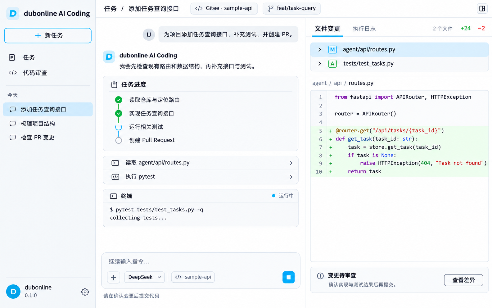

# dubonline AI Coding

版本：0.1.0

由 **dubonline** 维护的个人 AI 编码与代码审查工作台。通过本地工作区连接 Gitee 仓库，支持任务分析、技术方案、代码修改、Pull Request 创建与代码审查。

后端使用 Python、FastAPI、Deep Agents 和 LangGraph，前端使用 React、TypeScript 和 TanStack Start。任务状态和业务数据分别保存到本地 SQLite，界面通过 SSE 接收运行事件。

## 界面预览



*界面设计效果图，用于展示交互布局。*

## 环境与配置

- Python 3.14 或更高版本，使用 uv 安装依赖：`uv sync`。
- 前端依赖由 `ui/yarn.lock` 锁定，在 `ui/` 下运行 `yarn install --frozen-lockfile`。
- 将 `.env.example` 复制为 `.env`，填写模型服务、Gitee Token 和独立工作区路径。已有 `.env` 可继续使用。
- `.env` 中非空值优先于进程环境；空字段不会覆盖已有值。密钥不应提交到仓库。

当前执行后端以 Windows 本地工作区为主要运行环境。macOS/Linux 的命令执行和进程管理尚未完成全面适配；能够启动 API 不等于完整 Agent 工作流已经跨平台验证。

## 启动

在项目根目录启动 API：

```sh
uv run uvicorn agent.app:app --host 127.0.0.1 --port 2024
```

在 `ui/` 目录启动界面，并设置 `VITE_DASHBOARD_API_BASE_URL=http://127.0.0.1:2024`：

```sh
yarn dev --host 127.0.0.1
```

Windows 可使用 `scripts\start_backend.cmd`、`scripts\start_ui.cmd`，或 `.venv\Scripts\python.exe scripts\start_all.py`。

界面地址：<http://127.0.0.1:3000/agents>；健康检查：<http://127.0.0.1:2024/health>。

## 仓库与任务

在界面选择 Gitee 仓库，或在 `.env` 中设置 `DUBONLINE_AICODING_DEFAULT_REPO`。未指定仓库时，服务会明确提示，不会自动使用其他人的仓库。当前仅支持 Gitee；执行任务可能提交、推送代码并创建 PR，请使用自己有权操作的仓库。

也可向 `POST /api/tasks` 提交请求：

```json
{
  "repo_url": "https://gitee.com/<owner>/<repo>.git",
  "prompt": "分析项目结构并给出改进建议"
}
```

## 数据与日志

- `data/checkpoints.sqlite`：Agent 消息和状态恢复。
- `data/store.sqlite`：任务摘要、运行记录与审查结果。
- `data/plans/`：任务生成的方案。
- `logs/backend.log`、`logs/agent-runs.log`：当前日志，历史日志带日期后缀。

日志接口为 `/api/logs/backend`、`/api/logs/agent`，可通过 `?date=YYYY-MM-DD` 查询指定日期。历史数据与日志属于本地运行资产，品牌更新不会改写这些内容。

## 开发资料

设计记录统一归档为 2026年6月。

- [架构说明](docs/ARCHITECTURE.md)
- [后续扩展接口（未接入）](docs/EXTENSION_POINTS.md)
- [开发指南](docs/DEVELOPMENT.md)
- [配置说明](docs/CONFIGURATION.md)
- [Gitee Reviewer API 参考](docs/gitee-reviewer-api-reference.md)

本项目使用 Deep Agents、LangGraph、LangChain 等第三方组件，部分界面代码沿用 open-swe 的实现。相关来源说明及第三方许可要求应继续保留；项目由 dubonline 维护。
